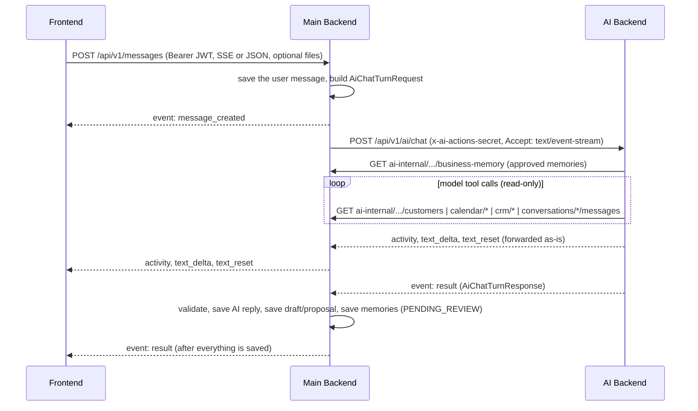

# AI Chat: Changes for Backend Developers

What changed between Main Backend and the AI Backend for the **Ask Laura** chat,
what it means for Main Backend, how the AI decides what to answer, and how the
two services talk to each other.

Related documents:

- [AI_BACKEND_UNIFIED_CHAT_STREAMING_HANDOFF.md](AI_BACKEND_UNIFIED_CHAT_STREAMING_HANDOFF.md) - the contract this implements
- [BUSINESS_MEMORY.md](BUSINESS_MEMORY.md) - the new memory module in detail
- [AI_CHAT_FRONTEND_CHANGES.md](AI_CHAT_FRONTEND_CHANGES.md) - what the frontend must do
- AI Backend repo: `AI_CHAT_API.md` - the AI side of the contract

---

## 1. Summary

| # | Change | Where | Action needed in Main Backend |
|---|---|---|---|
| 1 | One AI route, `POST /api/v1/ai/chat`, serves both JSON and SSE, with optional file uploads | AI | None: `AI_CHAT_STREAM_PATH` already defaults to it |
| 2 | `requester` is required in every chat request | AI | None: `AiChatContextService` always sends it |
| 3 | Multipart requests must send `Content-Length` (otherwise `411`) | Both | Done: `AiStreamingClient` now encodes the form itself |
| 4 | `customerId` is sent on task and meeting proposals by default | AI | None: already supported by `AiTaskActionPayloadDto` / `AiMeetingActionPayloadDto` |
| 5 | `reply.content` is now an **HTML fragment** | AI | Stored as-is; anything that shows it as text must strip tags (section 3.3) |
| 6 | Optional `memories` in the chat response, and a new **business memory** module | Both | Done: new module, plus a hook in `AiChatTurnService` |
| 7 | Clarification question ids may carry a date or time suffix | AI | Store questions **unchanged** (already the case) |
| 8 | Answer text streams live; `text_reset` is used more often | AI | None: events are forwarded as they are |
| 9 | New error codes (`411`, `MODEL_REJECTED_REQUEST`, `IDEMPOTENCY_UNAVAILABLE`, …) | AI | None: upstream statuses already pass through |
| 10 | The AI reads more from the AI-internal routes (customer listing, typo suggestions, memory) | AI | Keep those routes fast; see section 3.5 |

---

## 2. How Main Backend and the AI talk



Rules that do not change:

- **Main Backend owns all data.** The AI never writes to Main Backend. It only
  reads through the AI-internal routes with the shared secret, and returns
  proposals and memories for Main Backend to save.
- **Nothing executes without approval.** Tasks, meetings and CRM updates are
  proposals, executed by Main Backend after the organizer approves.
- **The `requester` comes from the authenticated sender** of the message, never
  from model output. Every AI-internal read is scoped to the organization and
  `requesterUserId`.

---

## 3. API changes and their impact

### 3.1 `POST /api/v1/ai/chat` (AI Backend)

**Request**

- `requester: { userId, name }` is **required**. `name` may be an empty string.
  A request without `requester.userId` is rejected with `400 INVALID_CHAT_REQUEST`
  before any work starts.
- Multipart (with files): the form fields are unchanged, but the request must
  carry `Content-Length`. Main Backend now builds the body as bytes:
  `src/modules/ai-integration/ai-streaming.client.ts` (`multipartRequest`)
  encodes the `FormData` with `new Response(form)` and sends a `Uint8Array`
  with the boundary `Content-Type`.
- Files are fully checked before any stream starts. Images are decoded: a
  damaged image is a `422`, and one over 50 megapixels is a `413`.

**Errors returned before the stream (JSON `{ code, message, retryable }`)**

| HTTP | Code | Retryable | New? |
|---|---|---|---|
| 400 | `INVALID_CHAT_REQUEST` | no | |
| 401 | `UNAUTHORIZED` | no | |
| 409 | `IDEMPOTENCY_CONFLICT` | no | |
| 411 | `LENGTH_REQUIRED` | no | new |
| 413 | `UPLOAD_TOO_LARGE` | no | |
| 415 | `UNSUPPORTED_FILE_TYPE` | no | |
| 422 | `INVALID_ATTACHMENT`, `CHAT_RESULT_INVALID`, `MODEL_REJECTED_REQUEST` | no | `MODEL_REJECTED_REQUEST` is new: the model refused the message or a file, so retrying cannot help |
| 408 | `CHAT_TIMEOUT` | yes | |
| 429 | `RATE_LIMITED` | yes | |
| 503 | `MODEL_UNAVAILABLE`, `IDEMPOTENCY_UNAVAILABLE` | yes | `IDEMPOTENCY_UNAVAILABLE` is new (the AI's Redis is down) |

After the stream has started, the same codes arrive as one `error` event.
`AiChatStreamingService` already marks the source message `FAILED` and forwards
the event. For a non-2xx response, `MessagesController` already passes the
status through.

### 3.2 SSE events from the AI

| Event | Change |
|---|---|
| `activity` | Stages: `planning`, `tool_started`, `tool_finished`, `agent_finished`, `reviewing`. New `tool` values: `business_memory`, `recall_business_memory`, `search_customers`, `list_calendar_events`, `get_calendar_availability`, `list_crm_objects`, `get_crm_fields`, `find_crm_records`, `context_check`. |
| `text_delta` | Now arrives **while the model is writing** (before, it came after the model had finished). Plain text. |
| `text_reset` | Sent when streamed text is withdrawn: the model looked something up first, or the final reply differs from the preview. |
| `result` | Unchanged shape (see 3.3 for the content format). |

Main Backend forwards all of these unchanged; no code change was needed.

### 3.3 Response changes (`AiChatTurnResponse`)

**`reply.content` is HTML**

```json
"reply": {
  "id": "chat-reply-<messageId>-v1",
  "content": "<p>To prepare the meeting proposal, I need a few details:</p><ul><li>What time should it start?</li><li>Zoom or Google Meet?</li></ul>",
  "agent": { "id": "...", "name": "Laura", "type": "CHIEF_OF_STAFF" }
}
```

- Only `<p> <br> <ul> <ol> <li> <strong>` are produced, without attributes, and
  all text is escaped. The AI switch is `CHAT_REPLY_FORMAT=html|text`.
- Main Backend stores it unchanged as the AI message `content`, and sends it back
  in `recentMessages`. The AI converts earlier HTML replies back to plain text
  itself, so nothing is needed in `AiChatContextService`.
- **Impact:** any backend feature that puts an AI message into plain text (email,
  notification, a preview, an export, a search index) must strip the tags first.
  Today no backend code does this; conversation titles stay `New Chat`.

**`customerId` on task and meeting proposals**

- Sent by default (`CHAT_EMIT_CUSTOMER_ID=true`), on proposals and on
  clarification draft payloads. It is the exact customer id the organizer
  confirmed: never an email, a provider id or a guess.
- `AiActionsService` already validates it against the organization and maps it
  to `contactIds` when the proposal is executed.

**Clarification question ids**

A draft can only hold a complete `startsAt` / `dueDate`, so a date given
without a time (or the reverse) is kept in the question id:

```text
meeting-start-time--on-2026-11-16
task-due-date--at-15-00
meeting-start-conflict--on-2026-11-16
```

The id is how the next turn remembers the date. **Main Backend must keep the
questions exactly as received** (it already does, in
`clarificationQuestions`) and send them back in `pendingDrafts[].questions`.
Ids stay within the validator's 128-character limit.

**Optional `memories`**

```json
"memories": [
  { "kind": "COMMITMENT", "content": "Send Kongkon the revised pricing by 2026-11-20.",
    "contactIds": ["6af40fef9ff07abe4d79f244"], "dueOn": "2026-11-20" }
]
```

There are at most 3 from the AI (the validator accepts up to 5). See 3.4.

### 3.4 New: business memory module

| Item | File |
|---|---|
| Enum (`BusinessMemoryKind`, `BusinessMemoryStatus`, `BusinessMemorySourceType`) | `src/common/enums/business-memory.enum.ts` |
| Schema, collection `business_memories` | `src/database/schemas/business-memory.schema.ts` |
| Module, repository, service | `src/modules/business-memory/` |
| Owner/admin routes `/api/v1/business-memory` | `business-memory.controller.ts` |
| AI-internal recall `GET /api/v1/ai-internal/organizations/:orgId/business-memory` | `ai-business-memory.controller.ts` |
| Response parsing (lenient) | `AiChatResponseValidator.memories()` |
| Saving after each turn | `AiChatTurnService.complete()` calls `BusinessMemoryService.ingestFromChat()` |
| Registration | `app.module.ts`, `ai-integration.module.ts` |

How it works:

1. The AI proposes durable facts the organizer stated: customers,
   preferences, meetings, commitments, responsibilities, goals, financial
   targets, decisions and open items.
2. `ingestFromChat` stores them as `PENDING_REVIEW`. It drops unknown customer
   ids, deduplicates by a per-organization fingerprint (`kind` + normalized
   content, unique index), caps a turn at 5 and **never throws**: a memory
   failure is logged and never fails the chat turn.
3. The owner approves, rejects, edits or archives them through
   `/api/v1/business-memory`. A rejected fact is kept, so it is not proposed
   again.
4. Only `ACTIVE` memories are returned to the AI by the recall route, in this
   order: about the turn's customers, then text search, then the latest goals
   and targets.

Indexes: `{organizationId, fingerprint}` unique, `{organizationId, status,
updatedAt}`, `{organizationId, status, contactIds}`, and text index
`{organizationId, content}`. They are created by Mongoose on startup.
**Production:** make sure index creation is allowed, or create them by hand.

Full API: [BUSINESS_MEMORY.md](BUSINESS_MEMORY.md).

### 3.5 AI-internal routes the AI now uses more

| Route | New usage | Load |
|---|---|---|
| `GET .../customers?search=` with an **empty** search | Lists customers ("show me all CRM customers"), limit 25 | 1 call per such question |
| `GET .../customers?search=&limit=100` | When a name has no match, the AI compares spellings ("kokon" -> "kongkon") | Up to 1 extra call per unmatched name |
| `GET .../business-memory` | Once at the start of every chat turn | 1 call per turn, bounded by `CHAT_CONTEXT_TIMEOUT_SECONDS` |
| `GET .../crm/{provider}/objects/{type}/records` | Record search scans up to 5 pages | Unchanged |

All of these are read-only and authenticated with `x-ai-actions-secret`. A
failing route never fails a turn: the AI answers without that fact.

---

## 4. How the AI makes decisions

Every turn runs one pipeline in the AI Backend (`src/chat_turn.py`). The model
proposes; **deterministic code decides what is returned.**

```text
1. Validate the request; claim the idempotency key (409 on a changed replay)
2. Recall approved business memory                      (GET business-memory)
3. Model call with read-only tools                      (customers, calendar, CRM, memory, older history)
   -> submit_chat_turn: action = CHAT | TASK | MEETING | CRM_RECORD_UPDATE | ASK_WHICH_DRAFT
4. Deterministic checks                                 (customer search, free slots, clashes, CRM schema/record)
5. Assemble exactly one result + reply + memories
6. Validate against AiChatTurnResponse; store for replay
```

What the code enforces whatever the model says:

| Area | Rule |
|---|---|
| Result type | `CHAT` -> `MESSAGE`; a task or meeting with missing required fields -> `CLARIFICATION`; complete -> `*_PROPOSAL`. A question that does not answer a pending draft is answered as `MESSAGE`, and the draft stays as it is. |
| Draft continuity | The draft id is derived from the first message (`chat-draft-meeting-<messageId>`) and kept across clarification turns. Several open drafts plus an unclear answer -> asks which one. |
| Dates | The model reads dates from a five-week calendar built from `context.currentTime` and `context.effectiveTimezone`. Vague times ("evening") are asked for. A partial date or time is remembered (3.3). A start in the past is asked again. |
| Invitees | Only emails the organizer wrote, or a CRM match they **confirmed**. A name that has not been confirmed asks for confirmation, with "Did you mean …?" for typos. |
| Customers | Confirmation is required even for a single match. `customerId` comes only from a confirmed Main Backend customer. |
| Calendar | A chosen time that clashes with an event is held back with free alternatives, unless the organizer explicitly keeps it. |
| CRM updates | Re-validated against the live schema and record: writable fields only, real option values, only changed properties, `expectedProviderUpdatedAt` from the record. |
| Reply text | Never claims something was created, scheduled, sent or updated: "ready for review". For grounded questions (CRM matches, free slots) a fixed reply is used, so the organizer sees what was found. |
| Memory | At most 3 facts per turn, never greetings or requests, never facts already approved, and Laura never says she saved anything. |
| Idempotency | The same `organizationId + idempotencyKey` with the same input returns the stored response (same ids). A concurrent duplicate waits. A failure or disconnect stores nothing. |

**Timezone.** `effectiveTimezone` is `requester.timezone || organization.timezone`.
An account left on UTC makes "3 pm" 15:00 UTC. Make sure users and organizations
have the right timezone.

---

## 5. Configuration

Main Backend `.env`:

| Variable | Value |
|---|---|
| `AI_SERVICE_URL` | AI Backend origin. Production: the deployed AI. Local testing: `http://127.0.0.1:8001` |
| `AI_SERVICE_SHARED_SECRET` | Same value as the AI's `AI_ACTIONS_SHARED_SECRET` |
| `AI_CHAT_STREAM_PATH` | `/api/v1/ai/chat` (default) |
| `AI_CHAT_TIMEOUT_MS` | ≥ `32000` (JSON transport) |
| `AI_CHAT_STREAM_TIMEOUT_MS` | `300000` |
| `REDIS_URL` | Required (BullMQ). The backend fails with `ECONNREFUSED 127.0.0.1:6379` when Redis is down |

AI Backend `.env` (for reference):

| Variable | Default | Notes |
|---|---|---|
| `BACKEND_API_URL` | - | Main Backend origin. A trailing `/api` or `/api/v1` is removed automatically |
| `AI_ACTIONS_SHARED_SECRET` | - | Shared secret |
| `CHAT_REPLY_FORMAT` | `html` | `text` for plain replies |
| `CHAT_EMIT_CUSTOMER_ID` | `true` | |
| `CHAT_REQUIRE_CONTENT_LENGTH` | `true` | |
| `REDIS_URL` | - | Shared idempotency for AI replicas on several hosts (can be Main Backend's Redis) |

---

## 6. Deploying and testing

1. Deploy the AI Backend first: older Main Backends ignore `memories` and
   accept HTML content.
2. Deploy Main Backend (`npm run build`). This adds the business memory module
   and its indexes.
3. Check: `GET /api/v1/ai-internal/organizations/{org}/business-memory?requesterUserId=…`
   with the shared secret returns `{ items: [] }`.
4. Test end to end with `tools/ai-chat-tester.html`. Open it in a browser, log
   in, and use the quick prompts. Its **Checks** tab verifies the event order,
   streaming, persistence, proposals and memories for every turn.

Tests: `npx jest src/modules/business-memory src/modules/ai-integration`.

---

## 7. Known follow-ups

- **Frontend:** render HTML replies, and add the business memory review page
  (see [AI_CHAT_FRONTEND_CHANGES.md](AI_CHAT_FRONTEND_CHANGES.md)).
- **Memories from meetings and calls:** today they come from chat only. Meeting
  and call analyses (`analyze-source`) can propose memories the same way.
- **Responsibilities** (`RESPONSIBILITY`) name the employee in the text;
  `userIds` is set only when the owner edits the memory.
- **ESLint** fails to load its config in this repo (`Identifier 'createRequire'
  has already been declared`), independently of these changes.
